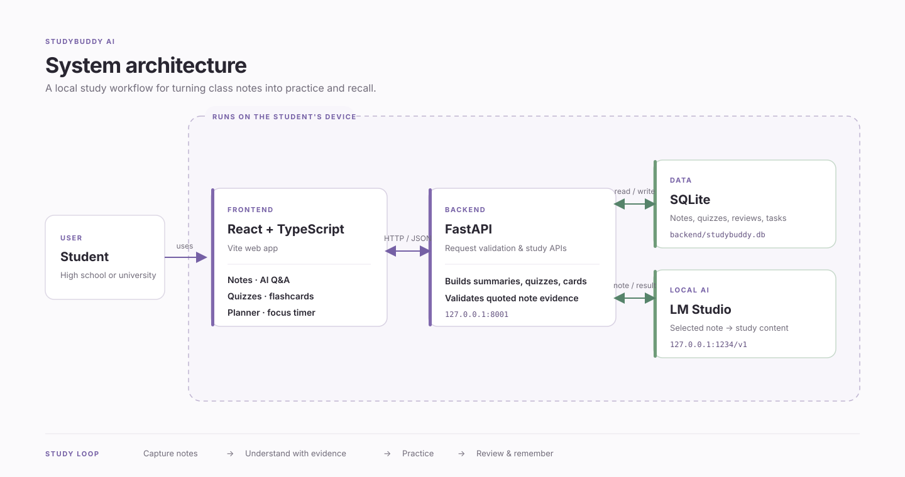

# StudyBuddy AI 👻

**Your notes. Your AI. Your study companion.**

StudyBuddy AI is built for high school and university students who prepare for tests from their class notes. It turns those notes into grounded answers, summaries, quizzes, and spaced-review flashcards, with a simple study planner. Notes and study data live in a local SQLite database.

## What you need

- Node.js 20.19+ (or 22.12+) and npm
- Python 3.10+
- [LM Studio](https://lmstudio.ai/) and a compatible chat model such as `deepseek-r1-distill-llama-8b` (only needed for AI generation)

## Start the app

Open two terminals from the project folder.

### 1. Start the backend

```powershell
cd backend
python -m venv .venv
.venv\Scripts\Activate.ps1
pip install -r requirements.txt
Copy-Item .env.example .env
python -m uvicorn app.main:app --reload --host 127.0.0.1 --port 8001
```

The API runs at `http://127.0.0.1:8001`. SQLite creates `backend/studybuddy.db` automatically.

### 2. Start the frontend

```powershell
cd frontend
npm install
npm run dev
```

Open the local address Vite prints (usually `http://localhost:5173`). If your backend uses another local port, set `VITE_API_URL` in `frontend/.env.local`, for example `VITE_API_URL=http://127.0.0.1:8001/api`. For privacy, the frontend rejects non-loopback API addresses.

## Connect local AI

In LM Studio, download/load your model and start the local server. The default address is `http://127.0.0.1:1234/v1`. Update `LM_STUDIO_BASE_URL` and `LM_STUDIO_MODEL` in `backend/.env` if needed. An optional local server key can be placed in `LM_STUDIO_API_KEY`; it is only read by the backend and is never sent to the browser.

The app remains usable for writing notes and planning when LM Studio is stopped. AI actions show a helpful message explaining how to start the local server.

## Features

- Dashboard with saved-data counts, recent notes, local AI status, and study shortcuts
- Create, edit, search, and delete notes
- Generate summaries, four-option multiple-choice quizzes, and flashcards from saved notes
- Score and retry quizzes; flip and navigate flashcards
- Review flashcards with Again / Hard / Good / Easy scheduling and a combined due queue
- Ask questions about a note and see supporting quotations checked against the original text
- Review weak quiz topics with a short, targeted follow-up quiz
- Add deadlines to study tasks and mark tasks complete
- Run task-linked focus sessions and keep a saved total study time
- Print an exam pack with notes, summary, quiz, and flashcards (choose Save as PDF in the browser dialog)
- Light and dark themes, responsive layout, and local SQLite persistence

## How it works



## Project map

- `.kiro/specs/`: requirements, design, and implementation checklist
- `frontend/src/`: React screens, styling, and typed API client
- `backend/app/main.py`: FastAPI routes and validation
- `backend/app/database/`: SQLite setup
- `backend/app/services/ai.py`: LM Studio integration and response validation

## Helpful commands

```powershell
cd frontend
npm run build
npm run lint
```

API health: `http://127.0.0.1:8001/api/health`. If AI is offline, check the LM Studio server toggle, loaded model name, and `LM_STUDIO_BASE_URL` in `backend/.env`.

## Privacy

This demo is single-user and stores notes, quizzes, tasks, and study activity in a local SQLite file. The database file is not encrypted by the app, so protect access to your device and backups. The browser sends data to the local backend; AI actions send the selected note to the configured LM Studio address. The backend rejects non-loopback LM Studio addresses to prevent accidentally sending note content to a remote host. No hosted AI provider is required. The interface uses system fonts and does not contact Google Fonts.

Generated answers and study materials may be incomplete or incorrect. Verify important information against your course materials. This demo does not provide legal, medical, or professional advice.

## License

MIT. See [LICENSE](LICENSE).
